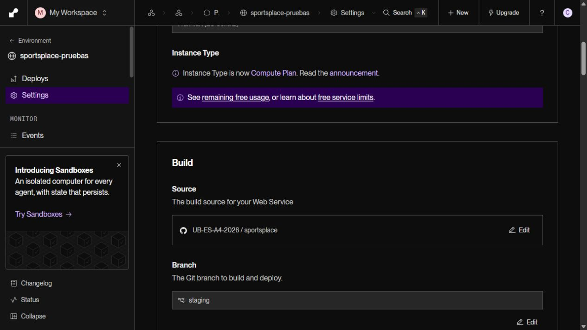
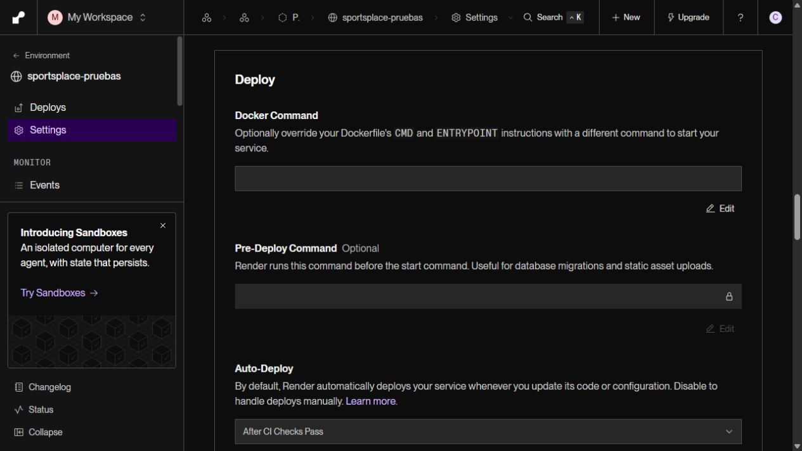
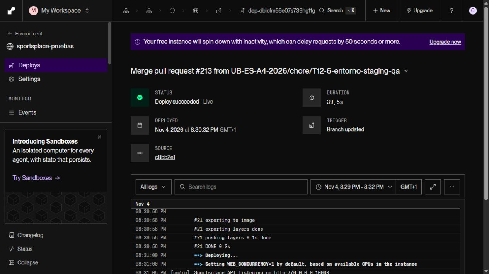

# T12-6 · Activación de staging el 4/11/2026

Responsable: Carlos. Seguimiento: [PR #213](https://github.com/UB-ES-A4-2026/sportsplace/pull/213).

## Rama y protección

`staging` se creó desde el `dev` actualizado tras integrar #213, con el SHA
`c8bb2e1ec3ab88056c829e633b3ddd92f7ea5314`. Se conservaron las ramas `test/...`
y `chore/T12-6-smoke-render-automatico`; el ejecutor sigue en `3572138`.

Carlos confirmó la copia de estas opciones desde la regla de `dev`:

- Require a pull request before merging.
- Require approvals: 1.
- Dismiss stale pull request approvals when new commits are pushed.
- Require status checks to pass before merging.
- Require branches to be up to date before merging.
- Require conversation resolution before merging.
- Do not allow bypassing the above settings.

El resto de casillas queda desmarcado, incluidas force push y eliminación.
La lectura pública del repositorio confirmó `protected: true` y los cuatro checks
siguientes, con origen GitHub Actions (`app_id: 15368`):

- Backend (lint y tests).
- Frontend (lint y build).
- Herramientas de migración (lint y tests).
- E2E (Playwright).

La lectura pública no expone todas las opciones de administración: las siete
opciones anteriores proceden de la confirmación de Carlos en el panel. Falta
adjuntar su captura de la regla completa en #213.

## Render configurado y despliegue por cambio de rama

Se guardó **Branch: staging** conservando **Auto-Deploy: After CI Checks Pass**;
ambos valores persistieron al volver a Settings.





El cambio de rama inició el [despliegue dep-dblofm56e07s739hg11g](https://dashboard.render.com/web/srv-dbh7tt3bc2fs73fr1i20/deploys/dep-dblofm56e07s739hg11g)
el **4/11/2026 a las 20:30:32, Europe/Madrid**: `Deploy succeeded | Live`,
duración 39,5 s, SHA `c8bb2e1...`, disparador **Branch updated**.
Es el despliegue del cambio de configuración; no se presenta como un Auto-Deploy
provocado por una nueva PR de promoción.



La comprobación desde el código de ese commit terminó con salida 0:

```text
Render sirve el commit esperado: c8bb2e1ec3ab88056c829e633b3ddd92f7ea5314.
Despliegue HTTP verificado: web compilada, rutas SPA, API y assets en el mismo origen.
```

No acredita Auth, PostgreSQL ni todos los criterios funcionales de QA. No se
cambiaron Supabase, las credenciales ni las migraciones como parte de esta activación.

## Primer push automático y límite de su evidencia

- [CI del push a staging, 41893440308](https://github.com/UB-ES-A4-2026/sportsplace/actions/runs/41893440308): cinco jobs correctos en el intento 2.
- [Dispatcher del push, 41893440077](https://github.com/UB-ES-A4-2026/sportsplace/actions/runs/41893440077): correcto, `event=push`, rama `staging`.
- [Smoke remoto automático, 41893463763](https://github.com/UB-ES-A4-2026/sportsplace/actions/runs/41893463763): correcto para el SHA inicial; finalizó a las 20:05:35, Europe/Madrid.

El intento inicial de CI falló con `fetch failed / write EPIPE` en el caso CA16 de
ocho fotos de 5 MB. Carlos repitió los jobs fallidos; el intento 2 terminó en verde.
No se omitieron pruebas ni se cambió código para obtener ese resultado.

El smoke terminó antes del cambio de rama de Render: el servicio ya publicaba
ese SHA desde `dev`. Acredita el disparador automático y el HTTP/SHA iniciales,
pero **no un Auto-Deploy posterior desde staging**.

## Primera promoción pendiente

La creación de staging dejó `dev` y `staging` idénticas. Esta actualización de la
evidencia es un cambio real de documentación para revisar e integrar en `dev`.
Después se podrá abrir la primera PR `dev` → `staging`, siempre con una aprobación
ajena, CI correcto y **Create a merge commit**, sin borrar ramas.

Tras esa promoción, registrar aquí y en #213 el SHA completo de staging, CI,
Auto-Deploy de Render y smoke automático posterior del mismo SHA. QA debe validar
la versión publicada antes de promover staging → main.
